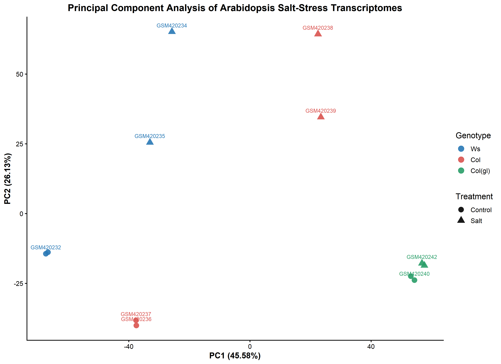
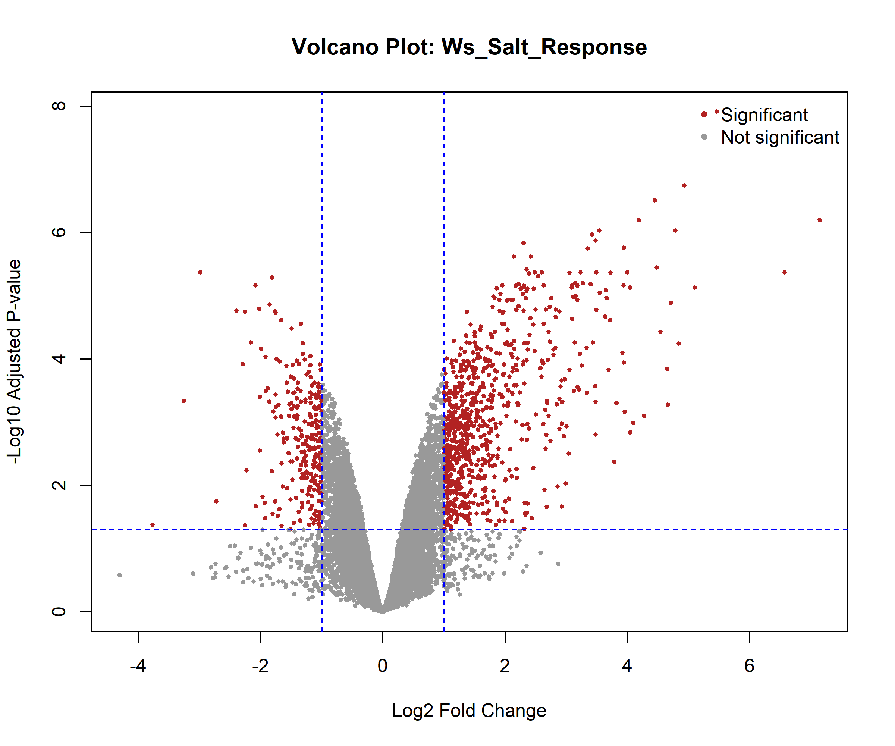
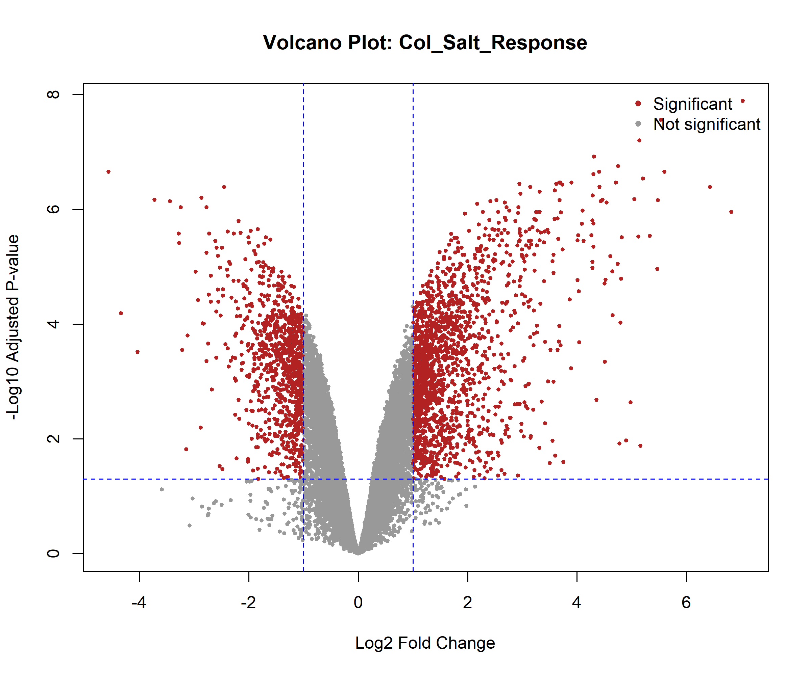
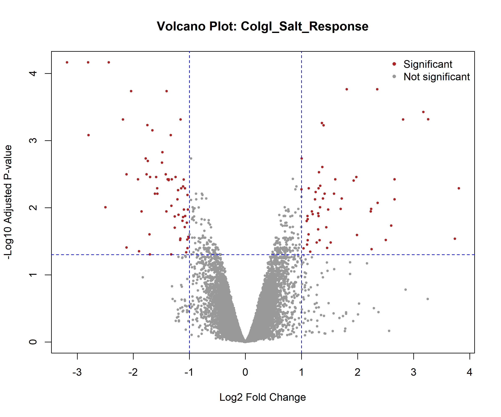
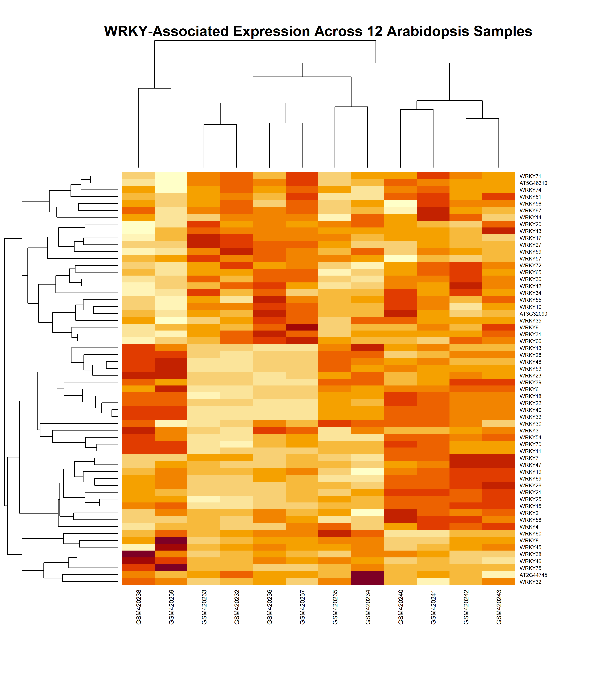

# Arabidopsis Salt-Stress Transcriptomic Analysis

## Project overview

This project examines transcriptional responses to salt stress in *Arabidopsis thaliana*, with a focus on differences among three genetic backgrounds: Ws, Col and Colgl.

The analysis uses a 12-sample Affymetrix ATH1 microarray dataset. The project was expanded from an initial four-sample analysis to investigate salt-associated gene-expression changes across three genotypes.

The workflow uses GEO-provided, RMA-normalised expression data and the `limma` framework for differential-expression analysis.

## Study design

The expanded analysis includes 12 samples representing:

- Three genotypes: Ws, Col and Colgl.
- Two treatment conditions: control and salt stress (100 mM NaCl).
- Two biological replicates for each genotype–treatment combination.

This design allows the examination of genotype-specific salt responses and differences in treatment responses between genetic backgrounds.

## Analysis workflow

### 1. Data retrieval and preparation

The workflow retrieves the public expression dataset using `GEOquery` and accesses the associated sample information and expression matrix.

The expression values supplied through GEO are used as the starting point. The analysis does not perform a second RMA normalisation step.

Sample metadata are organised according to genotype and treatment to support the expanded 12-sample design.

### 2. Exploratory data analysis

Exploratory analyses were performed to understand the expression dataset and assess sample-level patterns before interpreting differential-expression results.

These included:

- Inspection of sample metadata and expression-matrix dimensions.
- Examination of expression-value distributions.
- Assessment of sample-to-sample correlation.
- Principal component analysis (PCA) to explore overall expression variation and sample relationships.
- Examination of principal-component loadings and highly variable probe sets.
- Comparison of biological replicates.
- Exploration of genome-wide replicate differences.
- Examination of gene-symbol annotation completeness and selected functional annotation keywords.

These analyses provide context for interpreting the downstream results. They do not, by themselves, establish biological causation.

### 3. Differential-expression analysis

Differential expression was analysed using `limma`.

The expanded model evaluates five comparisons:

| Contrast | Biological question |
|---|---|
| Ws salt response | How does salt treatment affect expression in Ws? |
| Col salt response | How does salt treatment affect expression in Col? |
| Colgl salt response | How does salt treatment affect expression in Colgl? |
| Col vs Ws interaction | Does the salt response differ between Col and Ws? |
| Colgl vs Ws interaction | Does the salt response differ between Colgl and Ws? |

The interaction contrasts investigate differences in treatment responses between genetic backgrounds rather than simply comparing expression levels under one condition.

Adjusted p-values are used to account for multiple testing. The exported result tables retain probe-level statistical results for further inspection.

### 4. Differential-expression findings

The following counts summarise the results obtained using the specified statistical thresholds:

| Contrast | FDR < 0.05 | FDR < 0.05 and absolute log2FC > 1 |
|---|---:|---:|
| Ws salt response | 3,778 | 1,042 |
| Col salt response | 8,532 | 2,619 |
| Colgl salt response | 335 | 117 |
| Col vs Ws interaction | 1,059 | 652 |
| Colgl vs Ws interaction | 1,406 | 874 |

These counts represent probe-level statistical findings under the stated thresholds. They should be interpreted in the context of the limited biological replication.

### 5. WRKY-associated probe analysis

A separate analysis examines probe sets associated with WRKY transcription factors using platform annotation information.

The analysis includes WRKY-associated results across the three genotypes and a heatmap showing expression patterns across all 12 samples.

This is an annotation-based probe-set analysis. It should not be interpreted as proof of direct transcription-factor activity, DNA binding or regulatory interactions.

## Figures

The repository includes five final figures:

| Figure | Purpose |
|---|---|
| `PCA_All_12_Samples.png` | Visualises overall expression variation and sample relationships across the 12 samples. |
| `Volcano_Ws_Salt_Response.png` | Shows differential-expression results for the Ws salt response. |
| `Volcano_Col_Salt_Response.png` | Shows differential-expression results for the Col salt response. |
| `Volcano_Colgl_Salt_Response.png` | Shows differential-expression results for the Colgl salt response. |
| `WRKY_Heatmap_All_12_Samples.png` | Displays expression patterns of WRKY-associated probe sets across all samples. |
### Visualisations

**1. PCA — all 12 samples**



**2. Volcano plot — Ws salt response**



**3. Volcano plot — Col salt response**



**4. Volcano plot — Colgl salt response**



**5. WRKY-associated expression heatmap**



## Repository structure

```text
arabidopsis-salt-stress-final/
│
├── scripts/
│   └── analysis.R
│
├── figures/
│   ├── PCA_All_12_Samples.png
│   ├── Volcano_Ws_Salt_Response.png
│   ├── Volcano_Col_Salt_Response.png
│   ├── Volcano_Colgl_Salt_Response.png
│   └── WRKY_Heatmap_All_12_Samples.png
│
├── results/
│   ├── Salt_Stress_Full_Results.csv
│   ├── Ws_Salt_Response_Full_Results.csv
│   ├── Col_Salt_Response_Full_Results.csv
│   ├── Colgl_Salt_Response_Full_Results.csv
│   ├── Col_vs_Ws_Interaction_Full_Results.csv
│   ├── Colgl_vs_Ws_Interaction_Full_Results.csv
│   ├── WRKY_Associated_Probe_Results.csv
│   ├── WRKY_All_Three_Genotypes.csv
│   ├── Analysis_Summary.csv
│   └── Software_Versions.csv
│
├── README.md
└── LICENSE
```

## Reproducibility

### Requirements

- R 4.5.2 (version used during development).
- Bioconductor packages: `GEOquery` and `limma`.
- CRAN package: `ggplot2`.
- `rstudioapi` is used when available for identifying the active script location in RStudio.

### Install dependencies

Run the following commands in R:

```r
install.packages(c("ggplot2", "rstudioapi"))

if (!requireNamespace("BiocManager", quietly = TRUE)) {
  install.packages("BiocManager")
}

BiocManager::install(c("GEOquery", "limma"))
```

### Run the analysis

From the repository root, run:

```r
source("scripts/analysis.R")
```

Alternatively, from a terminal:

```bash
Rscript scripts/analysis.R
```

The script identifies its project location, sets the project root as its working directory and uses the `figures/` and `results/` directories for output.

An internet connection is required to retrieve the public GEO dataset.

Software and package-version information is recorded in `results/Software_Versions.csv`.

## Interpretation and limitations

Several points are important when interpreting the findings:

- The dataset contains two biological replicates per genotype–treatment combination. This limits statistical power and makes independent validation important.
- The Affymetrix ATH1 platform measures transcript abundance through probe sets; this is a microarray experiment, not RNA sequencing.
- Probe-set annotations and gene-level interpretations depend on the quality and specificity of the available annotation.
- Differential-expression results identify statistical associations and do not independently establish causation.
- WRKY-associated expression patterns do not demonstrate direct regulatory mechanisms.
- PCA and correlation analyses describe expression patterns but do not independently establish their biological causes.
- Interaction contrasts examine differences in salt-response patterns between genotypes.

The results should therefore be interpreted as evidence of expression-level associations in this dataset rather than definitive functional validation.

## Tools and methods

R, GEOquery, limma, ggplot2, Affymetrix ATH1 microarray data, exploratory data analysis, PCA, differential-expression analysis, interaction contrasts and probe-set annotation.

## Author

**Anant Kaushal**

GitHub: [ANANT-KAUSHAL](https://github.com/ANANT-KAUSHAL)
